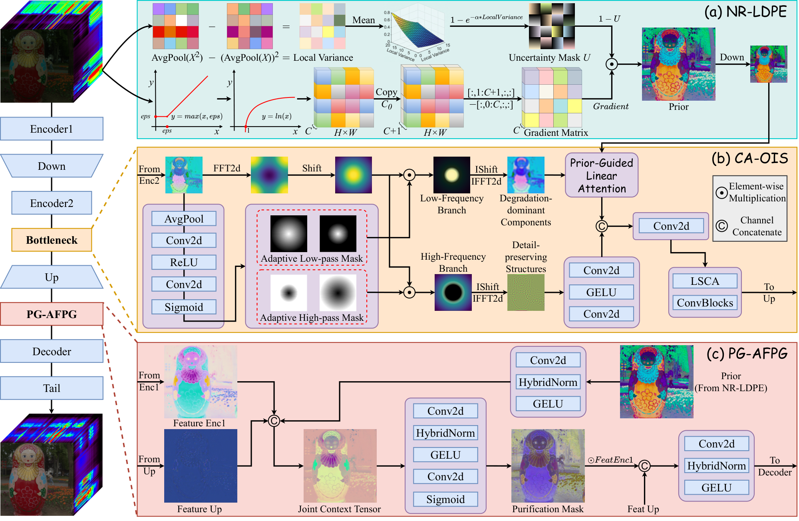
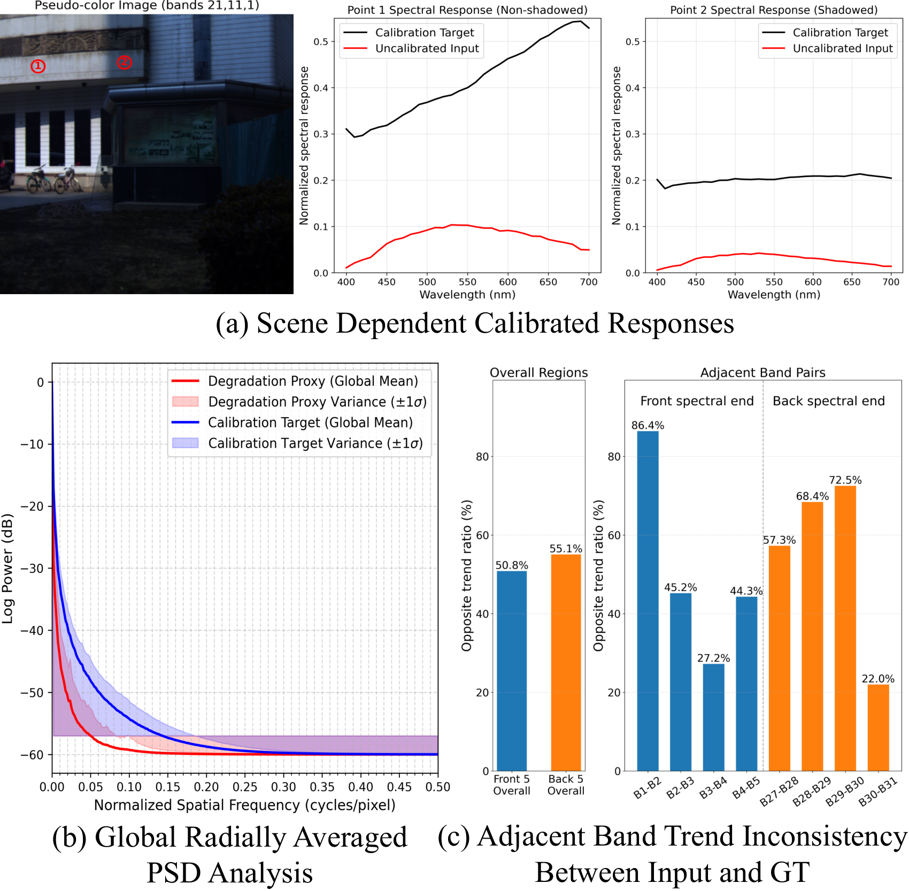
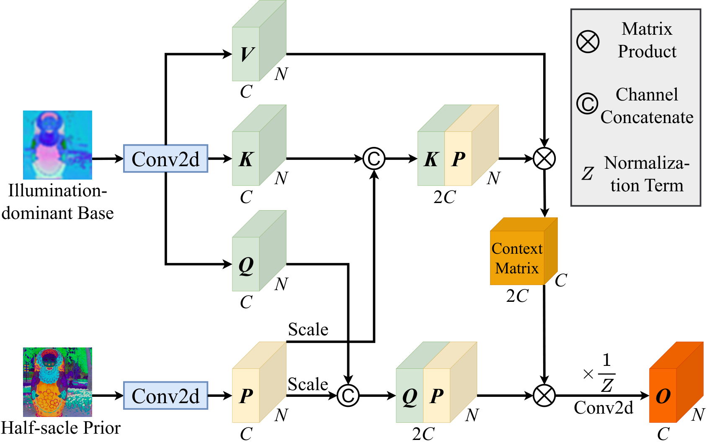
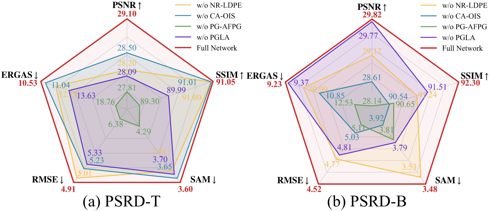
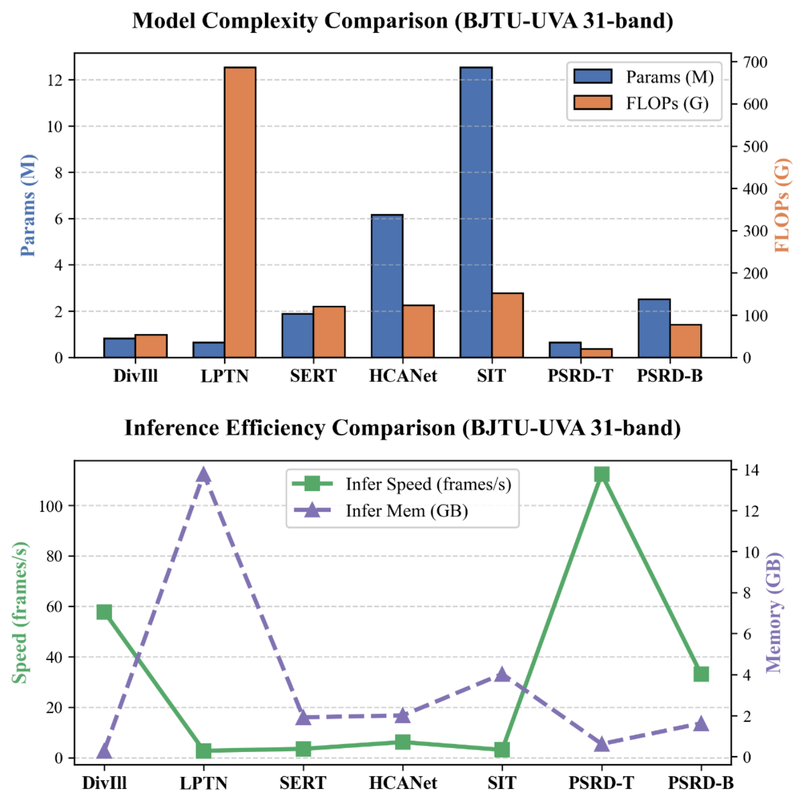
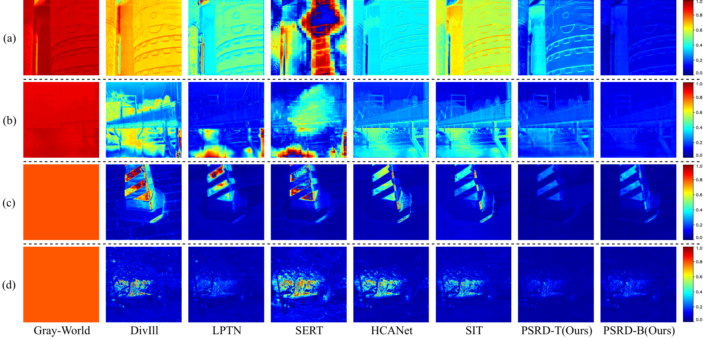
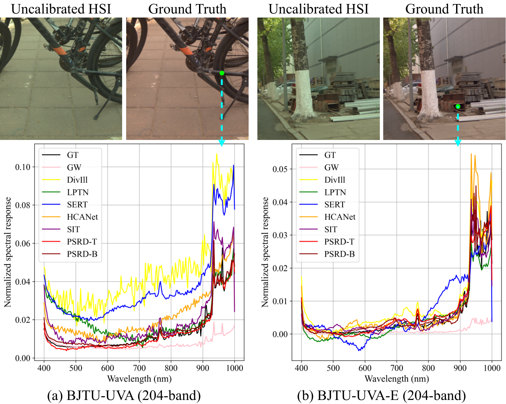

<div align="center">

# PSRD

### Physical Prior-Guided Spectral Reconstruction and Decoupling Network for Automatic Spectral Calibration of Hyperspectral Images

**Dian Li** · **Siyuan Hao** · **Yuanxin Ye**

*IEEE Transactions on Circuits and Systems for Video Technology*, 2026

[](https://ieeexplore.ieee.org/abstract/document/11733886)
[](https://doi.org/10.1109/TCSVT.2026.3742834)
[](#installation)
[](#installation)
[](LICENSE)

Official PyTorch implementation of **PSRD**, a physical prior-guided network for automatic spectral calibration (ASC) of hyperspectral images (HSIs).

</div>

---

## 📖 Overview

Hyperspectral images are exquisitely sensitive to the conditions under which they are acquired: non-uniform illumination, band-dependent response bias and dark current all distort the measured spectrum. **Automatic spectral calibration (ASC)** casts the remedy as a learning problem — predict the reference-calibrated hyperspectral response directly from a single uncalibrated observation, with no white panel and no paired acquisition at inference time.

PSRD treats ASC as an **implicit degradation restoration** problem rather than an explicit "estimate illumination and divide" pipeline:

$$
X \approx S \odot D + \mathcal{N},
\qquad
\hat{S} = X + F_{\theta}\big(X,\, P(X)\big)
$$

where $D$ is a smooth low-frequency degradation field, $P(X)$ is a physically motivated spectral prior, and the network only has to predict the **residual correction** on top of the observation.

The design rests on three calibration-oriented modules plus one efficiency mechanism:

- **NR-LDPE** extracts a log-derivative spectral-shape prior and gates it by local variance, so unreliable responses in noisy or low-signal regions are suppressed before they become guidance.
- **CA-CFD** splits the bottleneck feature in the Fourier domain with a content-adaptive radial mask, sending the degradation-dominant low-frequency part to a global branch and the detail-preserving high-frequency part to a local branch.
- **PG-AFPG** predicts a purification mask from encoder + decoder + prior, and filters shallow encoder features *before* they enter the skip connection.
- **PGLA** folds the prior into a linear-complexity attention kernel by feature augmentation, so global spectral–spatial reasoning costs $O(NC^2)$ instead of $O(N^2C)$.

<div align="center">

<br>
<sub><b>Figure 1.</b> Overview of PSRD. Left: the lightweight encoder–decoder with a single downsampling stage and an input-anchored residual output. Right: (a) NR-LDPE, (b) CA-CFD (labelled <i>CA-OIS</i> in the figure), (c) PG-AFPG.</sub>
</div>

---

## ✨ Highlights

| Feature | What it gives you |
|:--|:--|
| **Prior, not estimation** | The network never estimates an illumination field. A noise-gated log-derivative prior acts as a spectral-shape descriptor and enters both the attention kernel and the skip-fusion gate. |
| **Frequency decoupling** | A single global scalar $s \in [0.03, 0.13]$ predicted per image sets a Butterworth-style radial mask; $M_l + M_h = 1$ keeps the split exactly reconstructive, so the two branches stay complementary instead of drifting apart. |
| **Reliability-aware skips** | PG-AFPG suppresses degradation-contaminated shallow features. Removing it is the single most damaging ablation (ERGAS 10.53 → 18.76 on PSRD-T). |
| **Linear attention with prior affinity** | The prior term $\gamma \hat{P}_q \hat{P}_k^\top$ is absorbed into an augmented kernel $[\phi(Q), \sqrt{\gamma}\hat{P}_q]$, so the dense $N \times N$ affinity matrix is never materialised. |
| **Two sizes, one recipe** | **PSRD-T** (0.63 M params, 19.8 G FLOPs) and **PSRD-B** (2.51 M, 76.7 G) — the same architecture at a 4× compute budget, so you can pick the point that fits your deployment. |
| **Real-time inference** | 112.4 FPS (T) and 33.1 FPS (B) at 512 × 512 on a single RTX 4090, versus 3.1 FPS for the transformer-based SIT baseline. |

---

## 🔬 Why this design

The paper motivates the architecture with three measurements on the BJTU-UVA training set:

1. **Calibration targets are scene dependent.** Two visually similar points of the same material have clearly different target magnitudes under shadowed and non-shadowed conditions, so a single global gain cannot explain the data.
2. **Degradation and structure live in different frequency bands.** The radially averaged PSD of the degradation proxy is concentrated at low spatial frequencies, while the target keeps richer mid/high-frequency content.
3. **Adjacent-band trends disagree.** At both spectral ends, a non-negligible fraction of pixels flip the sign of their first-order spectral difference between input and target — ASC needs local spectral-shape correction, not intensity rescaling.

<div align="center">

<br>
<sub><b>Figure 2.</b> Empirical observations behind PSRD: (a) scene-dependent calibrated responses, (b) radially averaged PSD of degradation proxy vs. target, (c) adjacent-band trend inconsistency between input and target.</sub>
</div>

---

## 🧠 Method

### Components

| Module | Location | Role |
|:--|:--|:--|
| `NR_LDPE` | `model/PSRD.py` | Log compression → band-wise first-order difference → uncertainty gate $U = 1 - e^{-\alpha \bar{\mathcal{V}}}$ from a 3×3 local variance → $P = \mathrm{IN}(G \odot (1-U))$. |
| `PGLA` | `model/PSRD.py` | Linear attention with an augmented kernel: $Q' = [\phi(Q), \sqrt{\gamma}\hat{P}_q]$, $K' = [\phi(K), \sqrt{\gamma}\hat{P}_k]$, computed as $Q'(K'^\top V)$ with $\phi = \mathrm{ELU}+1$. |
| `DynamicFrequencyMask` | `model/PSRD.py` | Predicts the per-image cutoff $s$ by GAP → 1×1 conv (÷4) → ReLU → 1×1 conv → sigmoid, then builds the smooth radial low-pass mask ($n = 4$). |
| `CA_OIS` | `model/PSRD.py` | CA-CFD: FFT → fftshift → $M_l / M_h$ split → low branch through PGLA, high branch through a 3×3 local stream → 1×1 fusion. |
| `LSCA` | `model/PSRD.py` | Bottleneck spectral–channel attention: 4 heads, attention over channels ($C/h \times C/h$), 3×3 depth-wise conv on QKV, residual output. |
| `PG_AFPG` | `model/PSRD.py` | Prior projection + hybrid normalization → mask from $[F_e, F_d, \tilde{P}]$ → $F_e \odot M$ → 3×3 fusion with $F_d$. |
| `HybridNorm2d` | `model/PSRD.py` | $\alpha\,\mathrm{LN}_{2d} + (1-\alpha)\,\mathrm{IN}_{2d}$ with $\alpha = \sigma(a)$, $a$ initialised from `--init_alpha`. |
| `ConvBlock` | `model/PSRD.py` | $F + \rho \cdot \mathcal{C}_2(\delta(\mathcal{C}_1(F)))$, $\rho$ = `--residual_scale`. |
| `PhysicsInformedLoss` | `loss/char_sam_loss.py` | $\mathcal{L}_{char} + \lambda_{sam}\mathcal{L}_{sam}$ (Charbonnier + spectral angle). |

> **Naming.** The paper text calls the bottleneck decomposition **CA-CFD**; the architecture figure labels it **CA-OIS**, and the class in this repository is `CA_OIS`. They are the same module. Likewise **NR-LDPE**, **PGLA**, **PG-AFPG** and **LSCA** map one-to-one to `NR_LDPE`, `PGLA`, `PG_AFPG` and `LSCA`.

### Prior-guided linear attention

<div align="center">

<br>
<sub><b>Figure 3.</b> PGLA. The prior affinity is concatenated onto the projected queries and keys, which reproduces $QK^\top + \gamma P_qP_k^\top$ exactly while keeping the computation linear in the number of spatial tokens.</sub>
</div>

### Default configuration

| Symbol | Flag | Default | Meaning |
|:--|:--|:--:|:--|
| $d$ | `--dim` | 32 | Base width. `32` → PSRD-T, `64` → PSRD-B |
| — | `--num_blocks` | 2 | Residual conv blocks per encoder/decoder/bottleneck stage |
| $\rho$ | `--residual_scale` | 0.1 | Residual scaling inside `ConvBlock` |
| $\alpha_0$ | `--init_alpha` | 0.4 | Initial LN/IN mixing coefficient in PG-AFPG |
| $\lambda_{sam}$ | `--lambda_sam` | 1.0 | Weight of the spectral-angle term |
| — | `--epochs` | 500 | 500 for BJTU-UVA, **50** for BJTU-UVA-E |
| — | `--batch_size` | 1 | 1–4, depending on bands and memory |
| — | `--lr` | 1e-4 | Adam, stepped ×0.5 every `--lr_decrease_epoch` (200) epochs |
| — | `--crop_size` | 256 | Reserved: the cached patches are already 256 × 256 |

> The paper's sensitivity study covers $\alpha_0 \in \{0, 0.2, \dots, 1.0\}$ and finds $\alpha_0 = 0.4$ best for PSRD-T and $\alpha_0 = 0$ best for PSRD-B on BJTU-UVA (31-band). Each released checkpoint carries the $\alpha_0$ it was trained with in its filename.

---

## 📊 Results

### Reproduction with the released checkpoints

Both 31-band checkpoints were re-evaluated in this repository (RTX 4060, PyTorch 2.5.1, the 116-scene test split) and match the paper exactly:

| Model | PSNR ↑ | SSIM ↑ (%) | SAM ↓ | RMSE ↓ (%) | ERGAS ↓ | Paper (Table I) |
|:--|:--:|:--:|:--:|:--:|:--:|:--|
| **PSRD-T** (`dim32_alpha_04_BJTU_31`) | **29.1058** | **91.05** | **3.6049** | **4.91** | **10.5382** | 29.10 / 91.05 / 3.60 / 4.91 / 10.53 |
| **PSRD-B** (`dim64_alpha_00_BJTU_31`) | **29.8254** | **92.30** | **3.4896** | **4.52** | **9.2347** | 29.82 / 92.30 / 3.48 / 4.52 / 9.23 |

```bash
python test.py --dataset_name BJTU_31 --merged_root /path/to/BJTU_resample/merged_opt \
    --dim 32 --init_alpha 0.4        # → rmse:0.0491 psnr:29.1058 ergas:10.5382 sam:3.6049 ssim:0.9105
```

### BJTU-UVA — natural illumination

<div align="center"><sub><b>Table 1.</b> BJTU-UVA, 31 bands (400–700 nm). Best in <b>bold</b>.</sub></div>

| Method | Venue | PSNR ↑ | SSIM ↑ | SAM ↓ | RMSE ↓ | ERGAS ↓ |
|:--|:--|:--:|:--:|:--:|:--:|:--:|
| Gray-World | — | 21.55 | 60.15 | 10.08 | 11.86 | 17.67 |
| DivIll | ACM MM'21 | 23.90 | 76.42 | 4.05 | 8.96 | 15.63 |
| LPTN | TGRS'22 | 27.74 | 88.36 | 6.65 | 5.29 | 13.42 |
| SERT | CVPR'23 | 26.36 | 89.90 | 4.48 | 5.69 | 12.83 |
| HCANet | GRSL'24 | 28.61 | 90.54 | 4.95 | 4.91 | 12.44 |
| SIT | CVPR'25 | 28.86 | 90.59 | 4.07 | 5.03 | 10.49 |
| **PSRD-T** | Ours | 29.10 | 91.05 | 3.60 | 4.91 | 10.53 |
| **PSRD-B** | Ours | **29.82** | **92.30** | **3.48** | **4.52** | **9.23** |

<div align="center"><sub><b>Table 2.</b> BJTU-UVA, 204 bands (400–1000 nm). Best in <b>bold</b>.</sub></div>

| Method | PSNR ↑ | SSIM ↑ | SAM ↓ | RMSE ↓ | ERGAS ↓ |
|:--|:--:|:--:|:--:|:--:|:--:|
| Gray-World | 15.68 | 38.25 | 16.70 | 18.88 | 21.77 |
| DivIll | 22.02 | 79.21 | 8.21 | 8.74 | 14.21 |
| LPTN | 25.65 | 87.85 | 8.88 | 6.09 | 10.32 |
| SERT | 24.63 | 87.25 | 7.57 | 6.58 | 11.40 |
| HCANet | 26.51 | 89.14 | 7.49 | 5.62 | 9.52 |
| SIT | 26.35 | 88.69 | 7.41 | 5.87 | 9.32 |
| **PSRD-T** | **27.21** | 90.07 | 6.79 | **5.25** | 8.91 |
| **PSRD-B** | 27.06 | **90.98** | **6.24** | 5.37 | **8.88** |

### BJTU-UVA-E — ten illumination conditions

<div align="center"><sub><b>Table 3.</b> BJTU-UVA-E, 31 bands. Best in <b>bold</b>.</sub></div>

| Method | PSNR ↑ | SSIM ↑ | SAM ↓ | RMSE ↓ | ERGAS ↓ |
|:--|:--:|:--:|:--:|:--:|:--:|
| Gray-World | 18.89 | 42.56 | 9.33 | 13.41 | 22.49 |
| DivIll | 37.76 | 96.77 | 4.84 | 1.56 | 3.65 |
| LPTN | 42.40 | 98.58 | 3.03 | 1.01 | 2.65 |
| SERT | 41.74 | 98.56 | 3.27 | 1.08 | 2.81 |
| HCANet | 43.17 | 98.70 | 2.31 | 0.86 | 2.15 |
| SIT | 44.30 | 98.88 | 2.05 | 0.81 | 1.99 |
| **PSRD-T** | 45.36 | 99.14 | 1.87 | 0.77 | 1.97 |
| **PSRD-B** | **46.61** | **99.19** | **1.71** | **0.62** | **1.74** |

<div align="center"><sub><b>Table 4.</b> BJTU-UVA-E, 204 bands. Best in <b>bold</b>.</sub></div>

| Method | PSNR ↑ | SSIM ↑ | SAM ↓ | RMSE ↓ | ERGAS ↓ |
|:--|:--:|:--:|:--:|:--:|:--:|
| Gray-World | 14.84 | 24.88 | 16.07 | 19.90 | 24.74 |
| DivIll | 34.39 | 94.16 | 4.74 | 2.43 | 3.90 |
| LPTN | 37.20 | 95.55 | 4.42 | 1.58 | 2.48 |
| SERT | 36.90 | 95.57 | 4.50 | 1.66 | 2.54 |
| HCANet | 37.74 | 95.76 | 4.28 | 1.50 | 2.35 |
| SIT | 38.48 | 95.93 | 4.06 | 1.38 | 2.04 |
| **PSRD-T** | 39.49 | 96.35 | 3.48 | 1.22 | 1.66 |
| **PSRD-B** | **40.45** | **97.74** | **2.95** | **1.10** | **1.61** |

Per-condition breakdowns (ten illuminants × PSNR/SAM) are Tables III and IV of the paper. Against SIT on the 31-band set, PSRD-B gains the most under shadow (`sh`, +5.87 dB) and dusk (`du`, +3.89 dB); red-filtered illumination (`re`) stays the hardest condition for every method (best PSNR 39.93 dB).

### Ablation

<div align="center">

<br>
<sub><b>Figure 4.</b> Five-metric radar for PSRD-T (a) and PSRD-B (b) on BJTU-UVA (31-band), normalised so that larger is better. Removing any module shrinks the pentagon.</sub>
</div>

| Variant | Model | Reported effect |
|:--|:--|:--|
| w/o PG-AFPG | PSRD-T | ERGAS 10.53 → **18.76**; PSNR −1.29 dB (the largest single drop) |
| w/o PG-AFPG | PSRD-B | PSNR −1.68 dB |
| w/o NR-LDPE | PSRD-B | PSNR → 29.12 dB; SAM → 3.53 (edge preservation degrades) |
| w/o CA-CFD | PSRD-T | SAM → 3.65; RMSE → 5.23 % |
| w/o PGLA (local conv instead) | PSRD-T | PSNR 29.10 → 28.09; SSIM 91.05 → 89.99; ERGAS 10.53 → 13.63 |

> The tiny model leans hardest on PGLA: without global prior-guided reasoning its ERGAS rises by 29 %. The base model compensates partially through capacity, which is why the same removal costs it less.

### Efficiency

<div align="center"><sub><b>Table 5.</b> Complexity and inference cost at 512 × 512 on a single RTX 4090. Left block: 31-band. Right block: 204-band.</sub></div>

| Method | Params (M) | FLOPs (G) | FPS | Mem (GB) | Params (M) | FLOPs (G) | FPS | Mem (GB) |
|:--|:--:|:--:|:--:|:--:|:--:|:--:|:--:|:--:|
| DivIll | 0.81 | 53.4 | 57.8 | **0.29** | 1.01 | 66.5 | 50.8 | **0.61** |
| LPTN | 0.64 | 686.0 | 2.76 | 13.77 | **0.65** | 686.8 | 2.7 | 13.94 |
| SERT | 1.87 | 119.7 | 3.5 | 1.92 | 2.18 | 139.3 | 3.4 | 2.31 |
| HCANet | 6.15 | 122.4 | 6.2 | 2.01 | 7.05 | 181.1 | 6.0 | 2.23 |
| SIT | 12.53 | 151.2 | 3.1 | 4.03 | 13.42 | 209.9 | 3.0 | 4.30 |
| **PSRD-T** | **0.63** | **19.8** | **112.4** | 0.62 | 0.75 | **26.9** | **56.4** | 1.86 |
| **PSRD-B** | 2.51 | 76.7 | 33.1 | 1.63 | 2.74 | 90.9 | 24.5 | 1.87 |

> **Counting convention.** As in the paper's table, FLOPs are `thop` multiply–accumulates for a single 256 × 256 crop — the training crop size. Multiply by 4 for a full 512 × 512 scene (PSRD-T / 31-band: 19.8 G → 79.4 G MACs). Parameter counts measured with `torch` on the released checkpoints: 0.639 M, 2.510 M, 0.756 M, 2.742 M.

<div align="center">

<br>
<sub><b>Figure 5.</b> Accuracy–complexity trade-off on BJTU-UVA (31-band): parameters and FLOPs (top), inference speed and memory (bottom).</sub>
</div>

### Qualitative comparison

<div align="center">

<br>
<sub><b>Figure 6.</b> Absolute-error heat maps (cool blue ≈ 0, warm red ≈ 1). Rows: (a) BJTU-UVA 31-band, (b) BJTU-UVA 204-band, (c) BJTU-UVA-E 31-band, (d) BJTU-UVA-E 204-band.</sub>
</div>

<div align="center">

<br>
<sub><b>Figure 7.</b> 204-band spectral profiles at pixels (231, 395) and (367, 310) under natural and red-filtered illumination. Baselines drift in amplitude or spike near 950 nm; PSRD tracks the reference across 400–1000 nm.</sub>
</div>

---

## 📁 Repository structure

```text
PSRD/
├── model/
│   └── PSRD.py                 # NR-LDPE, PGLA, CA-CFD (CA_OIS), LSCA, PG-AFPG, PSRD
├── loss/
│   └── char_sam_loss.py        # Charbonnier + SAM objective
├── utils/
│   ├── dataset_bjtu.py         # 31-band BJTU-UVA cache loader
│   ├── dataset_bjtu_204.py     # 204-band BJTU-UVA cache loader
│   ├── dataset_bjtu_e.py       # 31-band BJTU-UVA-E cache loader
│   ├── dataset_bjtu_e_204.py   # 204-band BJTU-UVA-E cache loader
│   ├── resample.py             # 204 → 31 bands (400–700 nm, 10 nm step)
│   ├── split_data.py           # materialise per-split folders (optional)
│   ├── get_BJTU_E.py           # synthesise the ten illuminated variants
│   ├── create_BJTU_E_json.py   # build real_light_split_bjtu_e.json
│   └── merge.py                # pack pairs into memmap caches
├── checkpoints/                # eight released weights (see below)
├── images/                     # paper figures (PDF + PNG)
├── model_ini.py                # model / loss factory, run-name helper
├── metrics_torch.py            # PSNR, SSIM, SAM, RMSE, ERGAS on GPU
├── train.py / trainer.py       # training entry point / loop
├── test.py  / tester.py        # evaluation entry point / loop
├── real_light_split.json       # BJTU-UVA split: 535 / 114 / 116
├── real_light_split_bjtu_e.json# BJTU-UVA-E split: 5350 / 1140 / 1160
├── ill_sim.pkl                 # 10 measured illuminant spectra (204 bands)
├── requirements.txt
├── LICENSE
└── README.md
```

---

## ⚙️ Installation

<a id="installation"></a>

```bash
conda create -n psrd python=3.10 -y
conda activate psrd

# PyTorch matching your CUDA version, e.g. CUDA 11.8
pip install torch torchvision --index-url https://download.pytorch.org/whl/cu118

pip install -r requirements.txt
```

Requirements: **Python ≥ 3.10** and **PyTorch ≥ 2.0** (the paper uses 2.5.1). Training needs a CUDA GPU — a 24 GB RTX 4090 handles 204 bands at batch size 1–4. Evaluation also runs on CPU, but slowly.

---

## 🗂️ Data preparation

### 1. BJTU-UVA — real acquisition pairs

Raw layout: uncalibrated cubes `rw/rw_XXXX.npy` (204 bands, 12-bit) and reference reflectance `gt/gtRef_XXXX.npy`.

```bash
# (a) 204 → 31 bands (400–700 nm, 10 nm step), applied to both gt/ and rw/.
#     Edit input_gt / input_rw / output_gt / output_rw inside resample.py:main()
python utils/resample.py

# (b) (optional) materialise per-split folders for inspection
python utils/split_data.py

# (c) pack image pairs into memmap caches
#     Edit SCENE_DIR / GT_DIR / OUT_DIR / JSON_PATH inside merge.py first
python utils/merge.py
```

`merge.py` divides the raw 12-bit values by **4096** and stores `float32`.

### 2. BJTU-UVA-E — illumination-expanded benchmark

Every reference cube is multiplied wavelength-by-wavelength by the ten measured illuminant spectra in `ill_sim.pkl` (`du, sd, cd, rd, sh, ye, pu, re, bl, gr`):

```bash
python utils/get_BJTU_E.py          # gtRef_1287.npy → {du,sd,...}_rw_1287.npy under BJTU_E/rw/
python utils/create_BJTU_E_json.py  # every filename replicated with the ten prefixes
# then run resample.py and merge.py again with the BJTU_E paths
```

Splits: **5350 / 1140 / 1160**.

### 3. Cache format expected by the loaders

```text
<MERGED_ROOT>/
├── scene_train.npy   # (N, C, 256, 256) float32   ← train is CHW
├── gt_train.npy      # (N, C, 256, 256) float32
├── names_train.txt
├── scene_val.npy     # (N, H, W, C)               ← val/test are HWC
├── gt_val.npy
├── names_val.txt
├── scene_test.npy    # (N, H, W, C)
├── gt_test.npy
└── names_test.txt
```

The four loaders verify the channel count against `--in_channels` and raise a descriptive error on a mismatch. The 31-band caches are built from the resampled folders (`BJTU_resample`, `BJTU_E_resample`); the 204-band caches are built from the original folders (`BJTU`, `BJTU_E`).

---

## 🚀 Training

```bash
# ---------- BJTU-UVA, 31-band ----------
python train.py --dataset_name BJTU_31 \
    --merged_root /path/to/BJTU_resample/merged_opt \
    --dim 64 --init_alpha 0 --epochs 500 --batch_size 1 --lr 1e-4 \
    --save_by_epoch 10

# ---------- BJTU-UVA, 204-band ----------
python train.py --dataset_name BJTU_204 \
    --merged_root /path/to/BJTU/merged_opt \
    --in_channels 204 --out_channels 204 \
    --dim 32 --init_alpha 1.0 --epochs 500 --batch_size 1

# ---------- BJTU-UVA-E, 31-band (50 epochs) ----------
python train.py --dataset_name BJTU_E_31 \
    --merged_root /path/to/BJTU_E_resample/merged_opt \
    --dim 32 --init_alpha 0.9 --epochs 50 --batch_size 4

# ---------- resume ----------
python train.py --dataset_name BJTU_31 --merged_root /path/to/merged_opt \
    --resume_path checkpoints/psrd_dim64_alpha_00_BJTU_31/psrd_dim64_alpha_00_BJTU_31_epoch200.pth
```

**Outputs**

```text
checkpoints/<run_tag>/<run_tag>_epoch{N}.pth   # run_tag = psrd_dim64_alpha_00_BJTU_31
train_loss/psrd/train_loss_<run_tag>.txt       # per-epoch loss log
```

> ⚠️ `--save_by_epoch` defaults to **1**, which writes a checkpoint after every epoch (≈ 29 MB each for PSRD-B, so a 500-epoch run costs ≈ 14 GB). Use `--save_by_epoch 10` in practice.
>
> 💡 The validation routine (`val` in `trainer.py`) is implemented but commented out of the epoch loop, and only the `BJTU_31` branch builds a validation loader. Uncomment the `val(...)` call — and the corresponding `val_dataset` lines for the other settings — to log PSNR / RMSE / ERGAS / SAM / SSIM every 10 epochs, as described in the paper.

---

## 🔍 Evaluation

`test.py` derives the checkpoint path from the run tag, so the flags must match the file you want to evaluate:

```bash
# BJTU-UVA, 31-band
python test.py --dataset_name BJTU_31 --merged_root /path/to/BJTU_resample/merged_opt \
    --dim 32 --init_alpha 0.4        # PSRD-T
python test.py --dataset_name BJTU_31 --merged_root /path/to/BJTU_resample/merged_opt \
    --dim 64 --init_alpha 0.0        # PSRD-B

# BJTU-UVA, 204-band
python test.py --dataset_name BJTU_204 --merged_root /path/to/BJTU/merged_opt \
    --in_channels 204 --dim 64 --init_alpha 0.8

# BJTU-UVA-E
python test.py --dataset_name BJTU_E_31  --merged_root /path/to/BJTU_E_resample/merged_opt \
    --dim 32 --init_alpha 0.9
python test.py --dataset_name BJTU_E_204 --merged_root /path/to/BJTU_E/merged_opt \
    --in_channels 204 --dim 64 --init_alpha 0.7
```

A custom path can be given explicitly with `--model_path`. Results are appended to `test_results/<run_tag>/test_result_<run_tag>.txt`:

```text
rmse:0.0491	psnr:29.1058	ergas:10.5382	sam:3.6049	ssim:0.9105
```

### Released checkpoints

| Checkpoint | Setting | dim | α₀ | Epoch | Size |
|:--|:--|:--:|:--:|:--:|:--:|
| `psrd_dim32_alpha_04_BJTU_31.pth` | BJTU-UVA 31-band, **PSRD-T** | 32 | 0.4 | 468 | 7.5 MB |
| `psrd_dim64_alpha_00_BJTU_31.pth` | BJTU-UVA 31-band, **PSRD-B** | 64 | 0.0 | 500 | 29 MB |
| `psrd_dim32_alpha_10_BJTU_204.pth` | BJTU-UVA 204-band, PSRD-T | 32 | 1.0 | 421 | 8.8 MB |
| `psrd_dim64_alpha_08_BJTU_204.pth` | BJTU-UVA 204-band, PSRD-B | 64 | 0.8 | 500 | 32 MB |
| `psrd_dim32_alpha_09_BJTU_E_31.pth` | BJTU-UVA-E 31-band, PSRD-T | 32 | 0.9 | 50 | 7.5 MB |
| `psrd_dim64_alpha_08_BJTU_E_31.pth` | BJTU-UVA-E 31-band, PSRD-B | 64 | 0.8 | 48 | 29 MB |
| `psrd_dim32_alpha_08_BJTU_E_204.pth` | BJTU-UVA-E 204-band, PSRD-T | 32 | 0.8 | 49 | 8.8 MB |
| `psrd_dim64_alpha_07_BJTU_E_204.pth` | BJTU-UVA-E 204-band, PSRD-B | 64 | 0.7 | 49 | 32 MB |

Each file is a dict with `epoch`, `model_state_dict` and `optimizer_state_dict`, so it can also seed `--resume_path`.

---

## 📐 Metrics

All metrics are computed on reflectance in `[0, 1]`, per image and then averaged over the test set — see `metrics_torch.py`.

| Metric | Definition | Note |
|:--|:--|:--|
| **PSNR** ↑ | $10\log_{10}(1/\mathrm{MSE})$ | Peak fixed to 1.0 |
| **SSIM** ↑ | Band-wise SSIM, 11×11 Gaussian window (σ = 1.5), reported in % | Structural fidelity |
| **SAM** ↓ | Mean spectral angle in degrees | Spectral-shape fidelity |
| **RMSE** ↓ | $\sqrt{\mathrm{mean}((\hat{S}-S)^2)}$, reported in % | Radiometric accuracy |
| **ERGAS** ↓ | $\frac{100}{r}\sqrt{\frac{1}{C}\sum_c (\mathrm{RMSE}_c/\mu_c)^2}$, $r = 4$ | Global spatial–spectral error |

---

## 📚 Citation

```bibtex
@article{li2026psrd,
  title   = {Physical Prior-Guided Spectral Reconstruction and Decoupling Network
             for Automatic Spectral Calibration of Hyperspectral Images},
  author  = {Li, Dian and Hao, Siyuan and Ye, Yuanxin},
  journal = {IEEE Transactions on Circuits and Systems for Video Technology},
  year    = {2026},
  doi     = {10.1109/TCSVT.2026.3742834}
}
```

---

## 🙏 Acknowledgements

- The **BJTU-UVA** and **BJTU-UVA-E** benchmarks, and the SIT baseline, come from *Automatic Spectral Calibration of Hyperspectral Images: Method, Dataset and Benchmark* (CVPR 2025); the dataset is distributed at [mic.bjtu.edu.cn/data/bjtu-uva](https://mic.bjtu.edu.cn/data/bjtu-uva/).
- The linear-attention formulation follows [Transformers are RNNs](https://arxiv.org/abs/2006.16236) (Katharopoulos et al., ICML 2020).
- The `LSCA` bottleneck follows the channel-attention design of [Restormer](https://github.com/swz30/Restormer); the hybrid LN/IN normalization follows common practice in restoration transformers.

---

## ⚖️ License

Released under the [MIT License](LICENSE). Copyright (c) 2026 Dian Li, Siyuan Hao, Yuanxin Ye.

---

## 📬 Contact

**Dian Li** — [andorld@163.com](mailto:andorld@163.com) · GitHub: [@Andor-Li](https://github.com/Andor-Li)

For questions about the code, please open an issue. For questions about the paper, feel free to reach out by email.
